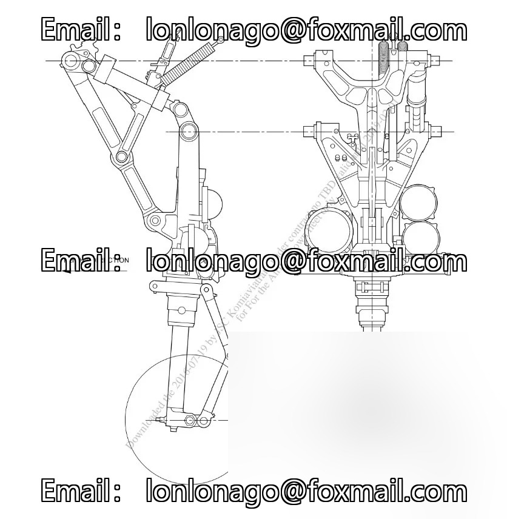
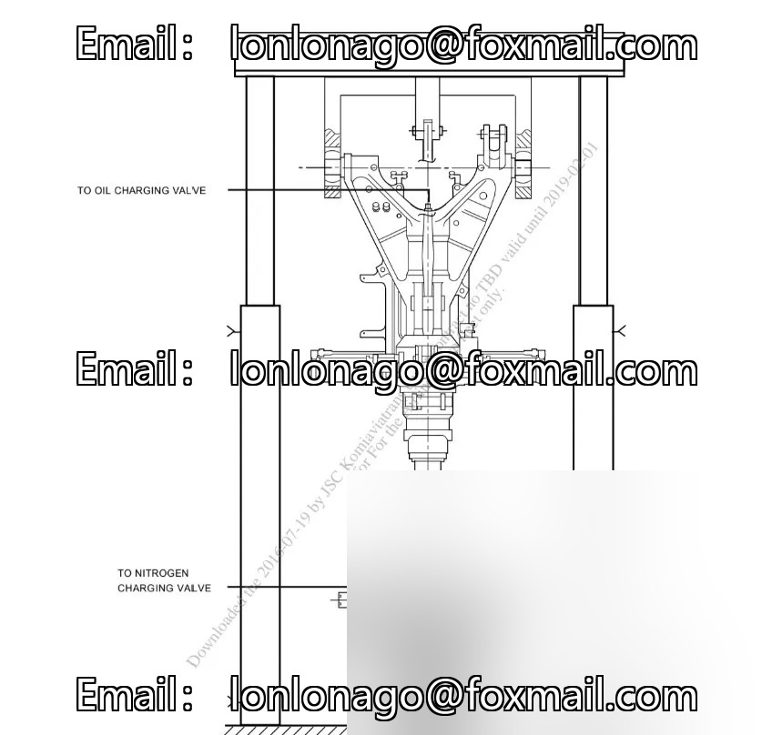
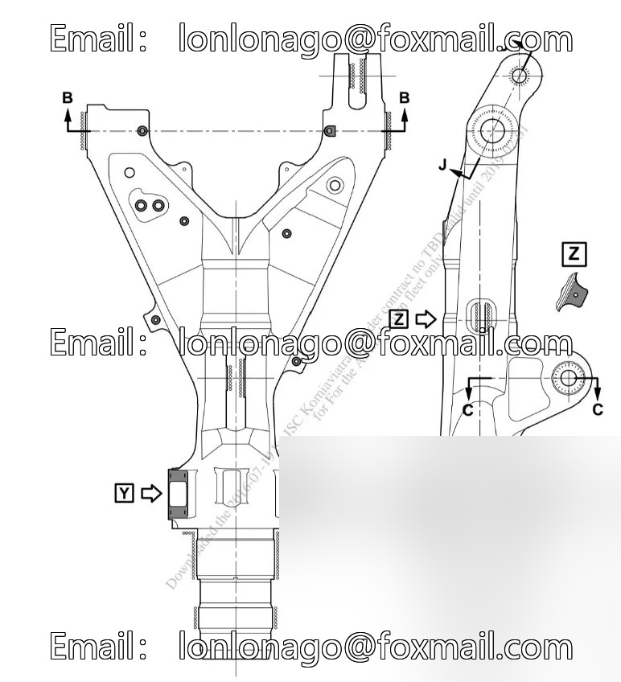
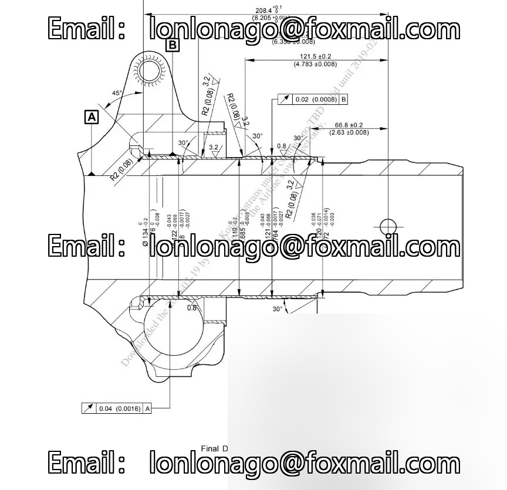
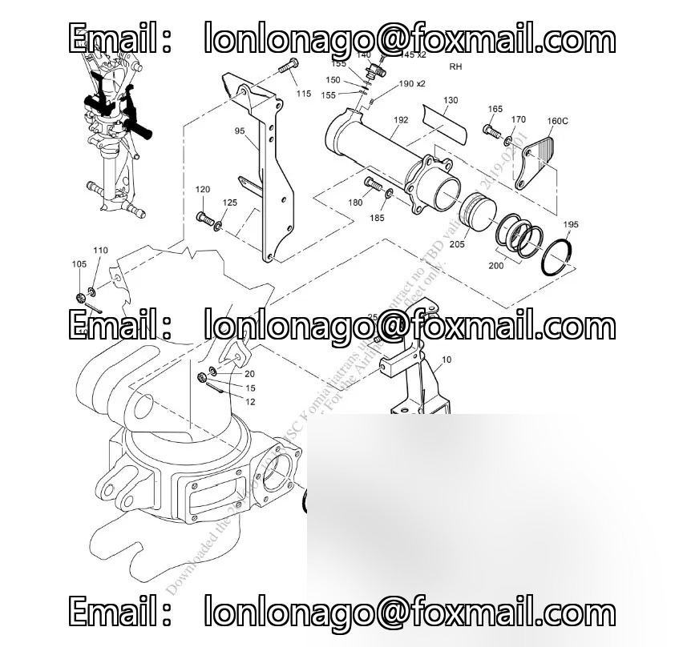

# Lieberher (LIEBHERR) company published part maintenance manual (Comp)

## Body

LIEBHERR (LIEBHERR) published Component Maintenance Manual.
Aeroplane component maintenance manual with illustrated part list.
PDF file 360 pages.
LIEBHERR-AEROSPACE LINDENBERG GmbH: A renowned German aircraft equipment manufacturer specializing in production of airplane air conditioning, hydraulic, and landing gear systems.
sold non-refundable.
895448021-32

The Component Maintenance Manual published by Liabher (LIEBHERR) covers part maintenance lists, illustrated guides and PDFs, amounting to 360 pages, including details on landing gear pillars.

<!-- AI_ENRICHED -->

## Images

## Payment

Here is a pay link on Stripe ( https://buy.stripe.com/3cs8yP7sY87d0vu9AB ). Please contact me lonlonago@foxmail.com after funding $89, and I will send you a complete data files , thank you!

